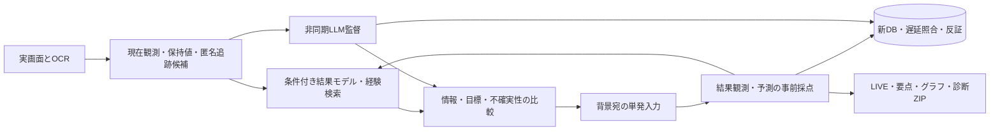
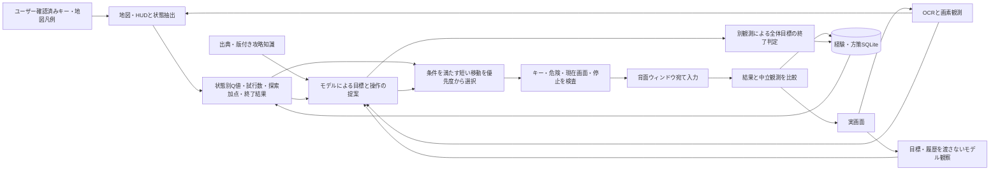

# 現行：0.24系 経験予測コア

UIの自動攻略入口は`nextgen/controller.py`。旧Controller・旧学習器は実行しない。キャプチャと入力・停止・手動介入・診断の外殻を共用する。

詳細・旧資産94モジュールの分類・新データ構造は[次世代設計](DESIGN-NEXTGEN.md)。以下は旧版の設計履歴で、現行の実行経路とは異なる。

---

# 0.6.0 知識・観測・方策学習・実行

全体目標は利用者が設定します。モデルは小目標を提案し、地図・HUDによる条件がそろう範囲では学習方策が探索の小目標と移動を選びます。採用した小目標を記憶と次の計画へ戻し、モデルの元案と実行した操作を混同しません。

`controls.py` が現在のユーザー確認済み操作とミニマップの意味を保持します。`minimap.py` が画像から色・形状の推定を行い、`policy.py` が状態・行動ごとの観測報酬、TD値、試行数、終了結果を学習・選択します。LLMの重みの再訓練ではありません。状態抽出と優先度の式・適用条件・限界は[LEARNING.md](LEARNING.md)に記載します。

`knowledge/torneko.json` はネット資料のID・URL・取得日・ハッシュ・種別と、各要約の対象版・出典を保持します。初代固有の規則はリマスターでは仮説として扱います。`KnowledgeEngine` は独立OCRの原文を保持し、数値・版・用語の候補を照合します。用語があるだけで効果や達成を証明しません。

`LocalLLM` は現在画像＋OCRだけの観察要求と、同じ画像・観察・攻略知識・経験ランキングからの計画要求を分離します。同じモデルであり、独立した正解器ではありません。例文・指示コピーや記録ラベルの混入は入力・攻略の事実に採用しません。

`MemoryStore` は経験・仮説・計画をSQLite/WALへ保存し、追加のpolicy表が行動学習を保持します。診断用のWM_NULL経路試験・中立観測は別の`diagnostics.sqlite`に保存し、成功報酬として取り込みません。OSへの送信受付とゲーム側の反応は別の情報です。無反応を未知Stateの可能性から切り離して故障にしません。

`FrameRecorder` は実画像とSHA・時刻・欠落を記録します。軽量ZIPは最新の判断画像と結果画像を優先し、単に更新時刻が新しい終了画像だけを提出しない構造です。大きいDBの省略時にも学習要約と直近更新を残し、大型ログは末尾を収録します。コピー機能は添付用ファイルのコピーであり、自動で外部送信しません。

UIは元ソース由来の統合コンソール内に「行動学習」「キー配置・ミニマップ」を追加しています。必要ランタイムの自動取得・通常起動・ウィンドウ位置保存・背面取得と入力・実機診断ZIPの流れは継続します。実機での攻略効果は未実証で、架空ゲームを成績の代用にしません。

`improvement.py` が停滞履歴を集計し、`LocalLLM.review_strategy()` へ有限な調整候補を監査要求します。提案→短期試行→観測評価→期限付き採用/撤回を独立した状態機械とSQLite表へ保存します。`policy.choose()` は安全条件を通過した候補内の優先度だけを調整します。モデルによる原因仮説と、機械的な観測評価は別であり、自己申告で成功認定しません。UIの「自己改善」と診断ZIPに同じ結果を示します。

0.7.1ではWindows OCRの同一エンジン内で全画面と上部ストリップを読み、上部は専用読取を使用し、比較用の全画面原文も保持します。OllamaのSchema失敗時は1回の汎用JSON回復とアプリ側検査を組み合わせ、観察応答不正の連続回数に上限を設けます。

0.7.2の`performance.py`は推論画像とプロンプトを小さくし、独立した画像観察→テキスト計画と、条件付き最大3手の方策継続を実装します。毎手のネイティブ解像度の観測・学習・入力保護は継続し、省略したLLM観察を捏造しません。performanceに各段階の所要時間と呼出の有無を保存します。

0.8.1では画像遮蔽処理を削除し、Controllerが表示中の地図を検出した場合に確認済みの標準メニュー操作を1回実行します。既存の入力保護と診断記録を使用し、設定操作を攻略報酬にしません。

## 0.9.0 共通プロファイルと復旧

`profiles.py`は実行ファイルとウィンドウクラスに基づくゲームIDと設定の原子的保存を担当する。選択時の接続は明示HWNDを使用し、タイトル変更を許容しながら別インスタンスを区別する。既存のトルネコ識別フォールバックはトルネコ名の接続だけに限定した。ゲーム・操作意味ごとのMemoryStoreにOCR、モデル仮説、操作結果を保存し、観測の類似度で過去経験を最大3件取得する。小目標・達成条件は汎用プロファイルでも未検証のモデル提案として保存する。

`interfaces.py`は独立した選択肢行とカーソル記号がOCRで明示された場合だけ方向/決定を選ぶ。適用には現フレームのハッシュ一致が必要。本文中の引用や未選択のYes/Noだけでは作動しない。未知は既存LLMへ戻す。`adaptation.py`は意味が既知の移動キーとgameplay場面に限り、有限個の押下時間を実攻略中に試す。OS送信受理・単独キー・中断なし・中立観測ありの結果だけ集計する。成功報酬やLLM重み更新ではない。

`recovery.py`は対象喪失と観測再試行を区別する。生存プロセス、起動した子プロセス、同一実行ファイルの別窓を確認し、停止と一時停止を尊重してバックオフする。復旧を挟んだ操作系列はMemoryStore.last_rowを切り、Controller/LLM/モーション観測を作り直す。起動失敗は学習しない。停止条件（利用者停止、時間/手数上限、確認済み達成、破壊的操作ブロック）は維持する。

ゲーム別状態アダプターや任意のコードをダウンロードして実行するプラグイン機構は未実装。Web検索APIも追加していない。画面取得・背景入力・ランチャーの互換性は実ゲームごとの確認を要する。

## 0.9.0 画面観測と背景操作への制約（最新方針）

ゲーム内メモリ/API/セーブ解析は導入しない。プロセス情報は識別と復旧のみ。攻略データは画面由来の画像/OCR、ユーザーのキー配置、公開資料、記録した観測で構成する。SendInputとSetForegroundWindowの未使用宣言も取り除いた。PrintWindow/対象宛PostMessageの明示失敗はBackgroundUnavailableとし、復旧ループでも前面入力に代替せずunsupported_backgroundで終了する。無反応や低信頼度をこの例外へ変換しない。

strategies.pyはゲームのジャンル・進行方式を未確認の仮説として保存し、grounded_text/structured_plan/temporal_review/visual_replanの評価をゲーム・場面別に保持する。3回可視条件の変化を確認できなければクールダウンを設け別手法へ移る。評価は出力妥当性、事前に固定した文字列の出現/消失、実測推論時間。フレーム不一致、OCR欠落、観測のみ、中断、未受理、自然変化との区別がつかない結果から肯定的な進捗を学習しない。モデルが決めた可視条件はゲームクリアの判定条件を置き換えない。

background.pyはOS受理数、背景送信数、背景での可視条件変化を区別し、因果や全キーの互換性を保証しない。research.pyは作品名だけを固定のWikipedia APIへ送り、未確認の候補を出典付きでキャッシュする。取得失敗は攻略の停止条件にしない。画面や履歴を外部へ送らない。

未知ジャンルに対するA*/盤面探索/リアルタイム制御器を実装したものではない。現在の非LLM処理は明示選択肢、経験検索、入力時間調整、評価/切替と既存トルネコ方策。任意ジャンルの攻略性能は実ゲームでの評価を要する。

## 0.9.2 応答性と処理分離

WindowCaptureは低水準の対象描画取得のまま保ち、実運用のWindowsGameはcapture_service.pyの常駐子プロセス経由で取得する。PrintWindowの停止不能呼出を本体から隔離し、4秒/キャンセル/接続断でツール自身の子だけを破棄する。子は入力せず、選択済みHWNDの描画取得とPNG化だけを行う。背景描画失敗時の対象外判定を維持する。multiprocessing spawnに必要なmainガードを本体エントリーとテストランナーに追加する。

cancellation.pyは停止/一時停止でHTTP/OCR待機を中断し、遅延結果を破棄する。通信中断はローカルLLMサーバー内の生成処理が即停止する保証ではない。Windows OCRは自前で起動したPowerShellだけをキャンセルする。ONNX処理は待機を中断できるが、実行中のネイティブ処理を強制停止する仕組みではない。

UIはpollのfinallyで更新を再予約し、コールバック例外をui-errors.logへ保存する。presentation.pyは表示量のみ制限し、学習/診断記録を改変しない。UI更新が止まればネイティブのfaulthandler監視がhang-traces.logへスタックを記録する。閉じる操作は5秒まで保存完了を待ち、その後は元ログを保持してUIを閉じる。ZIPの完成を待ち続ける構造にはしない。
