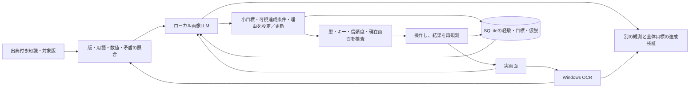

# 知識・観測・自律目標の構造

## 全体目標とLLMの目標

`Settings.goal` は利用者の全体方針。初期値は現在画面から開始・再開してゲームクリアを目指すもので、入力を必須にしない。LLMが全体方針を勝手に変更することはない。

LLMは各ターンで `subgoal` を決め、トルネコのプロファイルでは `goal_success`（画面で確認する達成条件）を必須で返す。`goal_evidence` は現OCRの引用、`reason` は選定理由。これを `autonomous_goal` として保存し、次の判断へ渡す。最終目標に必要な前提の確認、探索、回復、補給、退避、帰還などを選択・変更する主体はLLMである。目標はモデルの提案として記録し、達成した事実とは分ける。

## 知識とOCR

`knowledge/torneko.json` に資料のID・URL・取得日・取得ハッシュ・資料種別と、各要約の対象版・出典を保持する。初代固有の情報はリマスターでは仮説、版が不明なら候補とする。リマスターの調整設定やDLCを通常の初代攻略と同一視しない。

`ScreenOCR.read(png)` は認識エンジン、言語、時刻、画像SHA-256、行・語・矩形、利用可否を返す。将来別のOCRへ置き換える場合もこの辞書形式を使える。Windows APIに信頼度がないため架空の値を作らない。OCRの原文を保存したまま、日本語の単語間空白・全半角を用語照合時に正規化する。

`KnowledgeEngine.reconcile` はOCR用語と版を照合し、引用付きのHP・階層・満腹度の候補も作る。相反する複数値、不可能なHP・満腹度は採用しない。用語一致は文字を読んだ証拠にとどまり、アイテム効果やゲーム仕様の確認には昇格させない。

LLMは `knowledge_assessments` に支持・矛盾・保留と理由を返せる。現在フレームのOCRにある引用、既知の事実IDを持つ提案だけを保存する。保存後も未検証のモデル評価であり、元の出典を書き換えない。カタログのハッシュが違う評価は自動継承しない。

OCR・Web由来の文字列は観測・資料であり、ツールへの操作命令ではない。実行できるのは制御器が検証した許可キーだけである。

## 記録と検証

`MemoryStore` は全体目標・知識・対象ウィンドウ・許可キーで記憶を分離する。判断・操作・OCR・目標・知識評価をJSONLとSQLiteに保存し、再起動後も現在の目標と仮説を参照できる。過去の仮説や経路を現在の確定状態にはしない。

全体目標の完了宣言は、目標を伏せた別の画像観測、独立したWindows OCR、必要に応じた画素の色測定を用い、別呼び出しで検証する。OCR見出しとモデルのシーン分類が矛盾した場合、分類だけで決定せず矛盾を検証側へ渡す。大きなタイトル見出しや残る必須操作があれば完了にしない。根拠は独立観測に実在する文字列から選ばせる。

各構成要素の試験成功は実ゲームの完全攻略の証明ではない。対象ゲーム本体と利用可能な実行環境がないため、その実証は未完了である。

## 統合コンソールと実機診断

元ソースの共通操作・ライブ画面・観測→行動→結果・右側パネルに、LLMの小目標・成功条件・知識改訂を接続する。表示の折りたたみや実行時間は `ui-settings.json` に保存する。

`SessionControl` は一時停止・再開・停止・時間上限を扱う。一時停止をまたぐ推論結果は送信せず、新しく観測する。背面のWindowMessage入力は全体のキーボードキューを使用しない。

診断は同梱プロファイルの既知操作だけを使う別経路で、`DiagnosticStore` に保存する。`MemoryStore` とLLMの入力には接続しない。3往復または10分間の分離検証は、画面変化・復帰・前面への非干渉を満たさなければ成功にしない。

`ScreenOCR` は、導入済みのPP-OCRv5 → 日本語PP-OCRv4 → Windowsを選択できる。V5/V4のモデルは元ソースの実測SHA-256で検査し、外部RapidOCR/ONNX Runtimeで推論する。文字集合の制限は言語辞書だけで、攻略知識による文字の書き換えはしない。

`FrameRecorder` は判断前・結果の実画像を非同期保存し、画像ハッシュ・時刻・容量制限・欠落を記録する。終了・例外時に実行サマリーを書き、`export_diagnostics` がオンラインバックアップ・ログ・最新実行の画像・自動healthレポートをZIPへまとめる。大きなログは末尾を含め、切り詰めをmanifestに明示する。CF_HDROPのコピーはファイル添付を助けるローカル操作であり、他者への送信は行わない。

この経路の自動確認に架空のデモゲームは使用しない。実ゲームの描画・入力・認識・進行を確認する段階でのみ実機との連携が必要になる。
