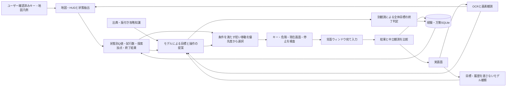

# 0.6.0 知識・観測・方策学習・実行

全体目標は利用者が設定します。モデルは小目標を提案し、地図・HUDによる条件がそろう範囲では学習方策が探索の小目標と移動を選びます。採用した小目標を記憶と次の計画へ戻し、モデルの元案と実行した操作を混同しません。

`controls.py` が現在のユーザー確認済み操作とミニマップの意味を保持します。`minimap.py` が画像から色・形状の推定を行い、`policy.py` が状態・行動ごとの観測報酬、TD値、試行数、終了結果を学習・選択します。LLMの重みの再訓練ではありません。状態抽出と優先度の式・適用条件・限界は[LEARNING.md](LEARNING.md)に記載します。

`knowledge/torneko.json` はネット資料のID・URL・取得日・ハッシュ・種別と、各要約の対象版・出典を保持します。初代固有の規則はリマスターでは仮説として扱います。`KnowledgeEngine` は独立OCRの原文を保持し、数値・版・用語の候補を照合します。用語があるだけで効果や達成を証明しません。

`LocalLLM` は現在画像＋OCRだけの観察要求と、同じ画像・観察・攻略知識・経験ランキングからの計画要求を分離します。同じモデルであり、独立した正解器ではありません。例文・指示コピーや記録ラベルの混入は入力・攻略の事実に採用しません。

`MemoryStore` は経験・仮説・計画をSQLite/WALへ保存し、追加のpolicy表が行動学習を保持します。診断用のWM_NULL経路試験・中立観測は別の`diagnostics.sqlite`に保存し、成功報酬として取り込みません。OSへの送信受付とゲーム側の反応は別の情報です。無反応を未知Stateの可能性から切り離して故障にしません。

`FrameRecorder` は実画像とSHA・時刻・欠落を記録します。軽量ZIPは最新の判断画像と結果画像を優先し、単に更新時刻が新しい終了画像だけを提出しない構造です。大きいDBの省略時にも学習要約と直近更新を残し、大型ログは末尾を収録します。コピー機能は添付用ファイルのコピーであり、自動で外部送信しません。

UIは元ソース由来の統合コンソール内に「行動学習」「キー配置・ミニマップ」を追加しています。必要ランタイムの自動取得・通常起動・ウィンドウ位置保存・背面取得と入力・実機診断ZIPの流れは継続します。実機での攻略効果は未実証で、架空ゲームを成績の代用にしません。

`improvement.py` が停滞履歴を集計し、`LocalLLM.review_strategy()` へ有限な調整候補を監査要求します。提案→短期試行→観測評価→期限付き採用/撤回を独立した状態機械とSQLite表へ保存します。`policy.choose()` は安全条件を通過した候補内の優先度だけを調整します。モデルによる原因仮説と、機械的な観測評価は別であり、自己申告で成功認定しません。UIの「自己改善」と診断ZIPに同じ結果を示します。

0.7.1ではWindows OCRの同一エンジン内で全画面と上部ストリップを読み、上部は専用読取を使用し、比較用の全画面原文も保持します。OllamaのSchema失敗時は1回の汎用JSON回復とアプリ側検査を組み合わせ、観察応答不正の連続回数に上限を設けます。

0.7.2の`performance.py`は推論画像とプロンプトを小さくし、独立した画像観察→テキスト計画と、条件付き最大3手の方策継続を実装します。毎手のネイティブ解像度の観測・学習・入力保護は継続し、省略したLLM観察を捏造しません。performanceに各段階の所要時間と呼出の有無を保存します。
