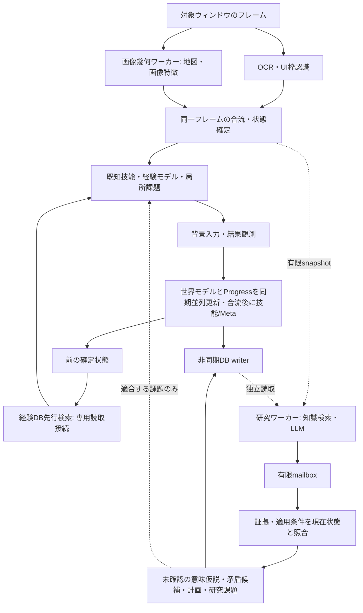

# 現場の同期並列パイプラインと非同期研究層（v0.30.0）

## 目的と実行経路

単にLLM呼出を別スレッドへ移す変更ではない。旧SemanticSupervisorもHTTP処理は
別スレッドだったが、問い合わせ前のDB検索とContext View作成は現場にあり、返答は
候補入力の採点に使われた。現行NextGenControllerはその経路を使用しない。
旧モジュールは保存形式/契約の互換性のため残す。

## 現場の同期境界

- OS操作・キャプチャと入力直前の再検証は所有スレッド。背景操作制約・手動介入・
  再接続・キー解放の既存契約を維持。LLMを待つ分岐はない。
- 同じPNGの地図幾何/縮小特徴を専用ワーカーで計算し、UI枠認識/OCRと重ねる。
  SHA256の一致を確認してから状態を構築。失敗や別フレームの結果を混ぜない。
- 経験ルールは直前状態から先行検索し、現在context/node/UI条件に合うキー集合を
  読み直して合流する。専用readonly SQLite接続（記号/Unicode対応URI）、最大512キー。所有スレッドの新しい
  キャッシュは上書きしない。明示的な不存在結果もキャッシュし、候補ごとの重複SQLを抑える。
  DBエラー時は既存の所有スレッド検索へフォールバックし、診断へ理由を出す。
- UI選択を反映した確定観測から、世界モデル更新とProgress評価を並行する。
  Progress管理器の所有権は一件の専用レーンへ独占移譲し、他レーンは参照しない。
  フレーム/手数を照合して合流した後、技能/Metaを更新する。例外時も必ず合流する。
  状態を同時に複数箇所から更新せず、永続化は既存の有限単一writerへ送信する。
- 戦闘メッセージの保護・入力後の安定待ち・中立観測による自然変化の分離は維持。
  必要な結果観測を省いて速さを装わない。全ての処理を非同期化したという主張ではない。

## ResearchLayer

現場tickはget_nowaitのmailbox、有限snapshotの作成、検証済み結果の所有スレッド適用だけ。
候補キー・候補ID・一手の採点をLLMへ渡さず、出力Schemaにも持たせない。
知識検索、予算内の証拠選択、プロンプト組み立て、推論は研究ワーカーが行う。
DBはそのスレッドが開いたreadonly接続を使い、元のreader/model/Observerは共有しない。

出力は次の候補だけ:

1. 意味・規則の抽象化: Evidence IDを引用し、INFERRED/UNCONFIRMEDとしてKnowledge Storeへ保存。
2. 矛盾整理: 異なる証拠参照を2件以上要求。矛盾候補として保存し、既存の直接観測を削除しない。
3. 長期の進行グラフ案: 固定ゲーム分岐ではなく、既存の前提/観測条件/反証条件DSLで検証。
4. 有限の研究課題: 抽象能力、適用条件、成功条件、4〜64手の期限。キーや押下時間は出せない。
5. 必要な情報の追加要求: 最大2件、専用読取接続でcold検索、一回だけ追加推論。
   新規OCR要求は既存の有限レートへキュー送信し、現場を停止させない。

LLMは画像を毎手処理せず、構造化観測と検索された経験を使う。
最終目的・作戦指示はsnapshotに含む。作戦/操作版が変われば保留中の研究をキャンセルし、
古い返答は採用しない。同時研究は1件、結果mailboxは1件、推論は原則最大90秒、
問い合わせ間隔は最低15秒かつ基準手数（進行不明/停滞時は32手まで前倒し）。
LLMなし/失敗/タイムアウト時も現場は既知技能と有限実験で続行する。

## 作成時Evidenceと現在状態の照合

研究snapshotはprofile・frame・step・current context・操作/作戦revision・領域/階・
進行ミッション・目標epochを持つ。Evidence IDの候補集合はリクエスト時に固定し、
追加検索で渡した情報のみ増やす。候補外・重複参照・不正な条件・入力フィールドを拒否する。根拠には作成時の構造化観測、
参照レコードの版ハッシュ/返却View/反証revisionを保持する。現在キャッシュで課題/計画が実際に引用した参照ルールに
新しい反証が増えていれば、その返答の現場計画/課題は採用しない。履歴的な意味仮説は保持する。

- profile/操作/作戦の不一致、キャンセル結果は破棄する。
- 意味の仮説は場面が変わっても過去の証拠を引用して保存できる。現在の観測とは扱わない。
- 計画/課題/新規観測要求は領域とミッションが一致し、256手以内で、提案の適用条件が
  全て現在観測でTrueの場合だけ採択する。適用条件が空なら作成時contextと同じことを要求。
- 課題や計画へ作成元frame/stepを保持。Progress達成はLLMの返答ではなく実測で判定。

ミッションが変わらない間の局所的な能力課題の変更だけで、長期研究を無条件に破棄しない。
研究の新規ノードIDはrun単位の名前空間を持ち、再起動時の同じ手数で旧ノードと衝突させない。
一方、適合しない課題を新しい場面の入力へ直接変換しない。

## 診断と人間からの観察

研究結果の意味仮説・矛盾候補・課題・計画・現場への適用可否を「認識・知識」/
「運用計画」に表示。ランプはLLM研究中と現場の独立継続を区別する。
Game_Knowledge.mdに「意味の仮説・矛盾整理」節を追加。正本は構造化DBのまま。

各手のperformanceに画像幾何join・経験prefetch join・研究mailbox/snapshotの時間、
llm_wait_ms=0、入力元/結果のframe、Progressのjoin時間、更新順序を残す。背景研究時間を一手の待機時間としない。

## 検証範囲・残る限界

自動検査はLLMをブロックしても実コントローラが入力2件と結果更新を終えること、
OCRと幾何計算の重なり、別フレームの拒否、profile分離/新しいルールの保護、
古い場面の意味仮説と現在課題の適用分離、引用検証、有限cold検索を確認する。
保存フレームとUIプリミティブを使い、架空のデモゲームは使用しない。

0.5秒/手や実ゲームでの攻略向上は未実証。OCR・OSキャプチャ・安定待ち・GPU競合は残る。
局所判断/技能更新を含む全処理の完全並列ではなく、整合性の必要な依存境界を持つ。
研究者が有用な意味や長期計画を生成できるか、知識が未知状況へ汎化するかは未実証。
学習した知識は正解とは限らず、矛盾候補を根拠に観測事実を消さない。
旧SemanticSupervisorの一手返信を新しい研究出力へ自動変換することもしない。
