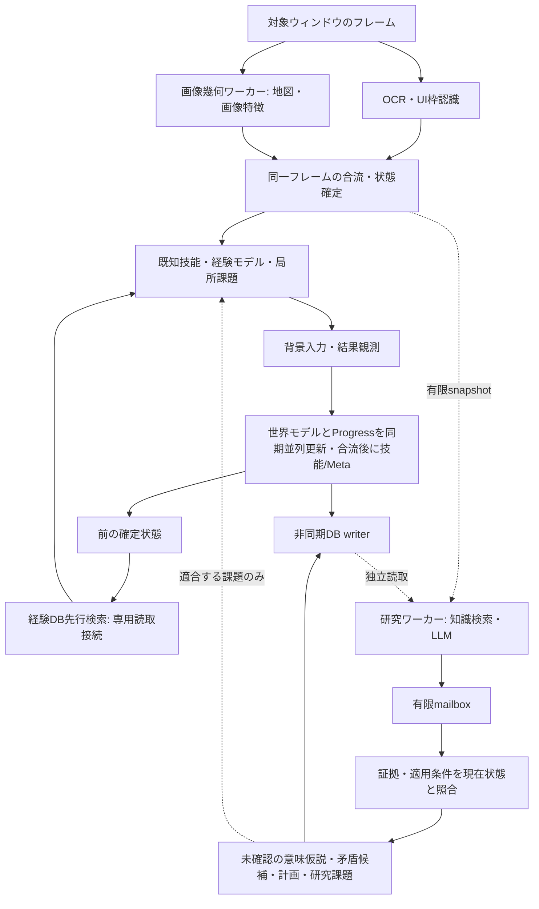

# 現場の同期並列パイプラインと非同期研究層（v0.30.0）

## 目的と実行経路

単にLLM呼出を別スレッドへ移す変更ではない。旧SemanticSupervisorもHTTP処理は
別スレッドだったが、問い合わせ前のDB検索とContext View作成は現場にあり、返答は
候補入力の採点に使われた。現行NextGenControllerはその経路を使用しない。
旧モジュールは保存形式/契約の互換性のため残す。

## 現場の同期境界

- OS操作・キャプチャと入力直前の再検証は所有スレッド。背景操作制約・手動介入・
  再接続・キー解放の既存契約を維持。LLMを待つ分岐はない。
- 同じPNGの地図幾何/縮小特徴を専用ワーカーで計算し、UI枠認識/OCRと重ねる。
  SHA256の一致を確認してから状態を構築。失敗や別フレームの結果を混ぜない。
- 経験ルールは直前状態から先行検索し、現在context/node/UI条件に合うキー集合を
  読み直して合流する。専用readonly SQLite接続（記号/Unicode対応URI）、最大512キー。所有スレッドの新しい
  キャッシュは上書きしない。明示的な不存在結果もキャッシュし、候補ごとの重複SQLを抑える。
  DBエラー時は既存の所有スレッド検索へフォールバックし、診断へ理由を出す。
- UI選択を反映した確定観測から、世界モデル更新とProgress評価を並行する。
  Progress管理器の所有権は一件の専用レーンへ独占移譲し、他レーンは参照しない。
  フレーム/手数を照合して合流した後、技能/Metaを更新する。例外時も必ず合流する。
  状態を同時に複数箇所から更新せず、永続化は既存の有限単一writerへ送信する。
- 戦闘メッセージの保護・入力後の安定待ち・中立観測による自然変化の分離は維持。
  必要な結果観測を省いて速さを装わない。全ての処理を非同期化したという主張ではない。

## ResearchLayer

現場tickはget_nowaitのmailbox、有限snapshotの作成、検証済み結果の所有スレッド適用だけ。
候補キー・候補ID・一手の採点をLLMへ渡さず、出力Schemaにも持たせない。
知識検索、予算内の証拠選択、プロンプト組み立て、推論は研究ワーカーが行う。
DBはそのスレッドが開いたreadonly接続を使い、元のreader/model/Observerは共有しない。

出力は次の候補だけ:

1. 意味・規則の抽象化: Evidence IDを引用し、INFERRED/UNCONFIRMEDとしてKnowledge Storeへ保存。
2. 矛盾整理: 異なる証拠参照を2件以上要求。矛盾候補として保存し、既存の直接観測を削除しない。
3. 長期の進行グラフ案: 固定ゲーム分岐ではなく、既存の前提/観測条件/反証条件DSLで検証。
4. 有限の研究課題: 抽象能力、適用条件、成功条件、4〜64手の期限。キーや押下時間は出せない。
5. 必要な情報の追加要求: 最大2件、専用読取接続でcold検索、一回だけ追加推論。
   新規OCR要求は既存の有限レートへキュー送信し、現場を停止させない。

LLMは画像を毎手処理せず、構造化観測と検索された経験を使う。
最終目的・作戦指示はsnapshotに含む。作戦/操作版が変われば保留中の研究をキャンセルし、
古い返答は採用しない。同時研究は1件、結果mailboxは1件、推論は原則最大90秒、
問い合わせ間隔は最低15秒かつ基準手数（進行不明/停滞時は32手まで前倒し）。
LLMなし/失敗/タイムアウト時も現場は既知技能と有限実験で続行する。

## 作成時Evidenceと現在状態の照合

研究snapshotはprofile・frame・step・current context・操作/作戦revision・領域/階・
進行ミッション・目標epochを持つ。Evidence IDの候補集合はリクエスト時に固定し、
追加検索で渡した情報のみ増やす。候補外・重複参照・不正な条件・入力フィールドを拒否する。根拠には作成時の構造化観測、
参照レコードの版ハッシュ/返却View/反証revisionを保持する。現在キャッシュで課題/計画が実際に引用した参照ルールに
新しい反証が増えていれば、その返答の現場計画/課題は採用しない。履歴的な意味仮説は保持する。

- profile/操作/作戦の不一致、キャンセル結果は破棄する。
- 意味の仮説は場面が変わっても過去の証拠を引用して保存できる。現在の観測とは扱わない。
- 計画/課題/新規観測要求は領域とミッションが一致し、256手以内で、提案の適用条件が
  全て現在観測でTrueの場合だけ採択する。適用条件が空なら作成時contextと同じことを要求。
- 課題や計画へ作成元frame/stepを保持。Progress達成はLLMの返答ではなく実測で判定。

ミッションが変わらない間の局所的な能力課題の変更だけで、長期研究を無条件に破棄しない。
研究の新規ノードIDはrun単位の名前空間を持ち、再起動時の同じ手数で旧ノードと衝突させない。
一方、適合しない課題を新しい場面の入力へ直接変換しない。

## 診断と人間からの観察

研究結果の意味仮説・矛盾候補・課題・計画・現場への適用可否を「認識・知識」/
「運用計画」に表示。ランプはLLM研究中と現場の独立継続を区別する。
Game_Knowledge.mdに「意味の仮説・矛盾整理」節を追加。正本は構造化DBのまま。

各手のperformanceに画像幾何join・経験prefetch join・研究mailbox/snapshotの時間、
llm_wait_ms=0、入力元/結果のframe、Progressのjoin時間、更新順序を残す。背景研究時間を一手の待機時間としない。

## 検証範囲・残る限界

自動検査はLLMをブロックしても実コントローラが入力2件と結果更新を終えること、
OCRと幾何計算の重なり、別フレームの拒否、profile分離/新しいルールの保護、
古い場面の意味仮説と現在課題の適用分離、引用検証、有限cold検索を確認する。
保存フレームとUIプリミティブを使い、架空のデモゲームは使用しない。

0.5秒/手や実ゲームでの攻略向上は未実証。OCR・OSキャプチャ・安定待ち・GPU競合は残る。
局所判断/技能更新を含む全処理の完全並列ではなく、整合性の必要な依存境界を持つ。
研究者が有用な意味や長期計画を生成できるか、知識が未知状況へ汎化するかは未実証。
学習した知識は正解とは限らず、矛盾候補を根拠に観測事実を消さない。
旧SemanticSupervisorの一手返信を新しい研究出力へ自動変換することもしない。

## v0.30.1 計測と有限の研究履歴

現場のメッセージ証拠抽出（画像選択・OCR・キャッシュ取得）の全時間をmessage_evidence_msへ記録し、保持できたフレーム数/実際のOCR呼出回数はperformance.message_evidenceへ単位を分けて記録。過去画像は現在のHP/階/地図へ巻き戻さない契約を維持する。

研究の採否と内容の要約をautonomyのresearchキーに最新8件保存する。各項目へsession/timeを付け、意味仮説/矛盾/課題/進行案は各1件の完全なレコードを抜粋する。集計は現在セッション単位、履歴だけは前回から保持。managerキーの制御状態と分け、diagnostic_summaryへ含める。全履歴や全知識を毎ターンUI/LLMへ載せない。全文の知識正本や派生Bookをこの要約に置換しない。

白枠検出のMaxFilter(3)をLマスクに対する分離最大値演算へ置換。境界の折返しを除去し、元の近傍最大値と同じ結果にする。閾値やOCR入力画質を変更しない。PNG復号/OCR/確実性のための待機は残り、これだけで高速制御の実機目標を達成したとはしない。

進行案だけの依存関係/形式の不正はproposal_issuesとrejected_progressへ記録し、採用しない。同じ返答の独立して有効な意味仮説/課題を保持できるようにする。許可外フィールド、不正引用、課題条件の不正はこの部分採用の対象にせず、全体を拒否する。進行案の修正や引用の捏造は行わない。エラー数は部分拒否も数えるため、有効応答数と排他的ではない。

研究履歴のエラー/部分拒否はrecent_failuresの専用投影で最大2件を次の研究へ返す。旧来のrecovery/mismatchだけのイベント選択で研究エラーが消えないようにし、拒否された進行案と理由を過去データとして照合できるようにする。これだけでLLM自身の修正成功を実証したとはしない。

## v0.30.2 経験→抽象化→再検索の接続

具体的な行動経験と、過去の研究仮説を同じ有限Evidence索引へ入れる。
抽象化の土台を内部の目標名/成功率だけにせず、前後の画面原文/数値/選択候補、実入力、送信結果、
観測効果と自然変化に置く。研究結果に入れた仮説が次の研究へ再検索される契約を追加する。

subjectとstatementが同じ正規化ラベル、目的文そのもの、長期意図の複数文を復唱した提案は
新規知識として保存せず、proposal_issues/rejected_knowledgeとして次の研究へ返す。
有効な他の提案は維持する。新しい意味を全て自動評価できる検査ではなく、単純な復唱を除く保守的な検査。
過去の同様な仮説は削除せず、通常の研究入力から外した理由とIDを有限索引に表示する。
明示的な過去情報の追加要求は引き続き可能。未確認内部文字/反証ありの進行ノードを依存先候補へ出さない。

仮説は依然INFERRED/UNCONFIRMEDまたはDISPUTED。入力前後の差が入力の因果だとは断定せず、
実験・反証・技能の成功条件とProgressの実測検証を必要とする。

局所研究課題のラベルそのものを未観測の画面文字条件にする案も、既存の根拠検査へ接続して保留する。現在または作成時の実観測/資料が根拠になる文字まで一律に禁止せず、rejected_tasksと理由を次の研究へ返す。単に「箱の取得」という内部名が出るのを待つ課題には戻さない。

## 0.30.3 根拠の役割と残る課題

進行ノード・長期目的・復旧記録・観測方策履歴は INTERNAL_CONTEXT、既存研究・仮説は HYPOTHESIS として提示する。これらだけを引用する研究知識は隔離し、現場へ適用できない過去の出力も同じ基準で検査する。観測、行動結果、外部情報などと合わせた仮説化は許すが、INFERRED/UNCONFIRMEDの扱いは維持する。通常検索で古い内部情報のみの研究記録を除外しても、正本を消去しない。

内部目標の長い部分文字列を説明文へ埋め込んだ復唱も除外する。同じsubject/statementを知識と矛盾へ二重提出した場合、矛盾側を除外する。これらは出所と形式のガードであり、異なる表現による言い換えや無意味な因果説明を完全判定する意味検証器ではない。

診断1793303257091532600（0.30.2）では20分146手、保存された末尾16手は兵士の説明会話を反復。LLM待機0msでも観測に数秒を費やしている。会話の長い周期を局所的な情報獲得より優先して抑止すること、不要な重複観測の削減、研究から実用技能へつながる意味的検証は未完。今回の根拠ガードをこれらの解決やゲーム攻略の実証とは扱わない。

## 0.30.4 現場の長周期反復

研究の意味的な改善を待たずに現場が反復を扱う。従来の入力込み完全一致（周期1/2/3/4/6）と4状態以下の滞留に加え、入力を除くbefore/after状態列の3周一致を周期2〜12で検査する。既存recent上限36件のままで、新規ノードやmetric/floor変化が履歴を解除する既存条件を維持。追加判定は全入力前後がquality>=0.7かつmeasurement_status=okの場合だけ使う。

反復は進行停滞の仮説であり、ゲーム世界の規則や因果の確定ではない。既存の有限8回脱出へ接続し、同じキーの80/140/220msを別の脱出案と数えないようキー集合で減点する。代替入力が有効である保証はなく、利用可能入力が同一なら停止や前面入力へ切り替えない。真の新規状態で解除する一方、OCR誤認によるID揺れや測定値の自然変化で検出できない場合は残る。恒久的なマス忌避やゲーム固有会話文の固定処理を追加しない。

## 0.30.5 反復経験の期限付き再利用

0.30.4実機ではcycles=1だったが末尾も兵士の会話を巡回。検出/一時脱出だけでは、再訪時に既知の入力を再選択する。ForwardModelは検出した系列の(context, before-state ID, sorted input keys)に96入力/1800秒の回避仮説を残し、通常選択で3点減点する。256件のLRU上限、profile分離、壁時計の期限と受理入力回数の双方で期限切れとなる。反復を証明済みのゲーム規則にはしない。未知状態の出現で一時脱出が終わっても、この期限付き経験は消さない。

現在の観測結果に対する既知の目標価値が正なら減点を解除する。別のcontextや状態には波及させず、床の踏破履歴に忌避を追加しない。既知グラフの経路選択も同じ減点を尊重する。代替の有効入力がある保証はなく、禁止や停止にはしない。

autonomy/cycle_avoidanceへ既存writerで保存。検出時と16入力ごと/全失効時にチェックポイントを作り、ディスク上のremainingはメモリより15小さく保存する。再起動で回数が増えず、保守的に最大15入力分早く失効することを許す。壁時計のexpires_atは再起動で更新しない。診断には期限付き記録、選択内remembered_cycle_discount、脱出結果内retained_cycle_entriesを残す。OCR揺れでcontext/state IDが違えば同一とは断定せず、この回避が適用されない限界は残る。

追加の境界観測: 系列内にinterface_hypothesis=False→Trueの遷移があれば、回避記録はその再入口に絞る。Trueの状態で文章を進めたりUIを閉じる入力まで一律に抑えて脱出を妨げないため。これは既存のinterface仮説に依存する再入口仮説であり、ゲームの会話定義ではない。境界が観測できない系列では従来どおり系列の組を期限付きで減点する。

## 0.31.0 UI復旧と自動ペース

空の条件の局所課題のままUIで反復する場合に、既存の回復予算にclose_unproductive_interfaceを追加。元目標をresumeとして保持し、一時的にinterface_open=0/close_interfaceをPlanner/Capabilityへ渡す。観測後の成立を技能学習と復旧成功の根拠にし、元の局所目標そのものの達成とはしない。期限8手/45秒と同じ意味目標・方法の再試行予算は既存通り。既知の閉じた結果をサンプルから抽出し、confidence>=0.6のグラフを最大4段探索する。UIを閉じる経路では単なる新規ノードへの寄り道を目的とせず、期限付き回避より既知の閉じる経路を優先できる。未知手順は固定しない。

PaceControllerは現場スレッド上の有限計算だけを担当し、LLMを呼ばない。profileは(context,sorted keys,protect_text)、LRU256件。8例の基準に対し待機を20%+10ms短くする8例試行を作り、平均手時間が短縮し品質が落ちなければ採用、失敗・不変なら以前の待機へ戻す。試行期限は120秒または全体64受理入力、失敗後16例の冷却。no_changeだけでは入力失敗にしない。予測不一致、品質0.7未満、入力直前の状態再検証失敗では短縮を撤回する。最低waitは0だが、TurnObserverの文字保護250ms/通常安定80msなどの観測制約は残す。OS送信とゲーム反応は引き続き分離する。

performance.paceはrolling32手の実経過（直前のログ/UI送出時間も含む）から毎分手数と1500msの目標に対する制約を記録。固定の速度上限を付けず、目標未達を診断可能にする。Paceは実行セッション内の実験値であり再起動時に未検証の短縮値を無条件復元しない。比較は観測代理指標であり統制されたゲーム攻略精度の実証ではない。OCRの内容的欠落を完全検出する能力は未完成である。

extra_capturesはbeforeの構築後ではなく前に取得する。追加取得画像に対してbeforeを1回構築し、neutral観測は別に保持、senseのフレームSHA一致を維持する。戦闘メッセージの中間フレームと最新afterのOCR経路は保つ。40手/分超は実機未確認であり、既存のOCRやゲームの反応時間が物理的な下限になる。

## 0.31.2 安定した有限復旧とペースの相対評価

Meta.ensure_localのbootstrapによる能力変更が、close_unproductive_interfaceを開始した直後にself.recovery=Noneとしていた。復旧中は期限/成立の検査へ所有権を残す。新しい利用可能な進行ノードがbootstrapより優先される場合のみsuperseded_by_available_progressを記録して移行する。通常のbootstrap変更には同一の候補を別frame SHAで2回確認し、同一フレームの呼び直しで確認を水増ししない。これはカーソル認識の正確さの保証ではない。

ペースの基準を8回の連続予測正解へ限定していたため、既存のWorld Modelの不一致が速度学習を止めていた。品質の良い観測は不一致も記録し、試行の一致率を基準より0.125超悪化させない。試行の予測が4例集まった時点または基準が全正解なら早期退行を判定する。未知の予測は正解へ変換せず比較対象外。品質の閾値0.7、タイムアウト、再検証、期限のガードは維持し、観測不足を速度のために許容しない。品質比較は最後の1例でなく試行平均と基準平均を使用する。performance.paceはbaseline_samples/trial_samples/blocked_by_observation/prediction_matchを追加し、試行不能の理由を次回診断で観察できる。

安全側への再検証: 移動/選択を裏付ける観測が失われてinspectに戻す場合は2フレームを待たず、観測不能の能力を継続しない。2フレーム確認は新しい操作能力を採用する側に適用する。復旧の所有権保護はclose_unproductive_interfaceに限定し、一般の観測試行が必要な能力再検証を妨げない。

## 0.31.3 Forward Modelの経路条件と反証

0.31.2診断では5手目の選択aのscore=0.215（d等の未試行候補0.862）でもroute_to_informationで上書きされ、6手目もd（score=0.108）へ上書き。経路は状態IDの接続だけを見て過去の稀なノードへ向かい、現在contextや辺の反証を見ていなかった。

新しいgraph辺はorigin_context/destination_contextを保持し、BFSは(node,context)を連鎖照合する。最大4段・2048辺の既存上限を維持。旧データの条件なし辺は保留して再観測から検証し直す。観測品質0.7以上・計測okの遷移だけを支持回数へ加算し、同じ始点/context/入力から違う行き先へ遷移した場合は既存辺へcounterexamplesを加算する。経路利用の重みは観測品質×support/(support+counterexamples)、0.6未満は保留する。低品質の欠測を反証に変換しない。

graphの主キーは引き続き(origin,action,destination)のため、同じ辺を別contextで観測し直す場合は現在のcontextに支持/反証を分離して集計し直す。全観測の正本はtransitionsに残る。条件一致は将来成功の保証でなく、過去の観測関連として扱う。

明示的な目標がある場合は稀なノードへ行く新規性で目的地を置換しない。採用時はroute_evidenceに目的地と辺ごとの条件・支持・反証を記録する。既知床の踏破回数に忌避を追加せず、条件付きの順路と目標達成を優先する。
